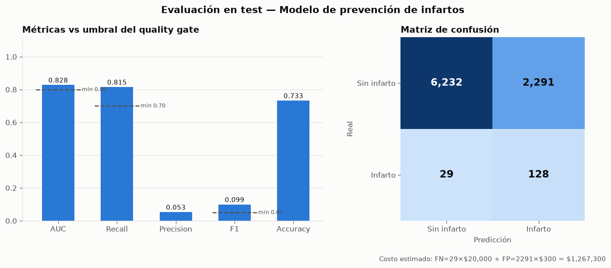

# Prevención de infartos en asegurados — Pipeline MLOps

Proyecto final del curso **MLOps: Del Modelo al Entorno Productivo** (Smart Data, 4ta edición).

Una aseguradora quiere identificar a los asegurados con alto riesgo de infarto para incluirlos
en un programa de prevención, y así evitar costos de cuidados intensivos y pagos de cobertura.
Este repositorio lleva el modelo del notebook del caso a un pipeline reproducible que se ejecuta
con un comando, valida los datos y la calidad del modelo antes de desplegarlo, versiona cada
modelo en MLflow, lo sirve como API en Docker y monitorea el drift.

El código reutiliza la estructura, las funciones y las librerías del repositorio del curso
(Unidades 1 a 10). La base es el pipeline de 7 etapas de la Unidad 10.

## Inicio rápido en GitHub Codespaces

1. En GitHub: **Code → Codespaces → Create codespace on main**. El contenedor
   (`.devcontainer/`) instala Python 3.11, las dependencias, DVC y Docker.
2. En la terminal del Codespace (Ctrl+`):

```bash
python main.py --demo    # todo de punta a punta (~5 min la primera vez, por el build de Docker)
```

`--demo` corre las 7 etapas, la demo de drift simulado, el build de la imagen Docker con
smoke tests contra el contenedor, y deja arriba la UI de MLflow (puerto 5000) y la API
(puerto 8000, `/docs`) hasta Ctrl+C. En Codespaces ambos puertos aparecen en la pestaña PORTS.
El reporte de drift que queda en `reportes/` es el del lote simulado.

| Comando | Para qué sirve |
|---|---|
| `python main.py` | Ejecuta las 7 etapas en secuencia (lo mismo que corre CI) |
| `python main.py --serve` | Las 7 etapas y luego MLflow UI + API arriba, con smoke tests |
| `python main.py --steps drift_demo docker` | Solo las etapas opcionales: drift simulado y Docker |
| `python main.py --steps random_forest evaluate` | Ejecuta solo algunas etapas |
| `make test` | Tests unitarios y de la API con cobertura |
| `make mlflow-ui` | UI de MLflow en el puerto 5000 (runs, Model Registry) |
| `make comparar` | Tabla comparativa de runs (GridSearch vs RandomSearch) |
| `make drift-demo` | Monitoreo con un lote de drift simulado |
| `make docker-build && make docker-run && make smoke` | API en Docker + smoke tests |
| `make preprod-up` | Stack pre-producción: MLflow + trainer + API |
| `make deploy VERSION=v1.0.0` | Despliegue con smoke tests y rollback automático |
| `make dvc-repro` | El mismo pipeline, reproducido con DVC |
| `make help` | Todos los comandos |

## Pipeline

```
data/raw/dataset_infartos.csv
   │
   ▼  1. download       data/run.py            valida columnas (cargar_datos)
   ▼  2. preprocess     preprocess/run.py      imputa IMC, crea variables *_Encoded
   ▼  3. segregate      segregate/run.py       split 80/20 estratificado
   ▼  4. check_data     check_data/            11 tests de schema, rangos y distribución
   ▼  5. random_forest  random_forest/run.py   GridSearchCV + RandomizedSearchCV → MLflow
   │                                           el mejor se registra en el Model Registry (Staging)
   ▼  6. evaluate       evaluate/run.py        quality gate AUC / Recall / F1 en test
   │                                           si aprueba: Staging → Production
   ▼  7. drift          drift/run.py           Evidently + PSI, train vs test
   │
   ▼  api/ (FastAPI)  →  Docker  →  GitHub Actions
```

Si una etapa falla, `main.py` se detiene y CI no construye la imagen. Todos los parámetros
están en `config.yaml`.

## Resultados

Random Forest con undersampling dentro de la validación cruzada, sobre las 7 variables del
notebook del caso. El mejor de los dos runs de tuning (RandomizedSearchCV, CV F1 0.096) se
evalúa una sola vez en el test holdout (8,680 asegurados, 157 infartos):

| Métrica (test) | Valor | Umbral del quality gate |
|---|---|---|
| AUC | **0.828** | ≥ 0.80 |
| Recall | **0.815** (128 de 157 infartos detectados) | ≥ 0.70 |
| Precision | 0.053 | — |
| F1 | 0.099 | ≥ 0.05 |
| Accuracy | 0.733 | — |



**Cómo leer estos números.** Con solo 1.8% de infartos, un modelo que siempre diga "no" tiene
98% de accuracy y no detecta a nadie. Por eso el gate exige recall y AUC. La precisión baja es
el costo esperado de priorizar el recall: por cada infarto detectado entran ~18 asegurados
sanos al programa de prevención. Con los supuestos de costo de `config.yaml`
(US$20,000 por infarto no detectado y US$300 por chequeo preventivo), el modelo cuesta
US$1.27 M frente a los US$3.14 M de no hacer nada (157 × US$20,000).

### Comparativa de modelos

La línea base (Regresión Logística con los parámetros de `MODELOS_DEFAULT` de la Unidad 2)
se entrena en cada ejecución con el mismo balanceo y la misma validación cruzada que el
tuning, y se evalúa en el mismo test. El test se usa solo para la línea base y el modelo
elegido; la selección se hace por validación cruzada.

| Modelo | Train AUC | CV F1 | CV Recall | CV AUC | Test AUC | Test Recall | Test F1 |
|---|---|---|---|---|---|---|---|
| Baseline: Regresión Logística | 0.823 | **0.096** | 0.770 | 0.820 | 0.825 | 0.815 | **0.102** |
| Random Forest (GridSearchCV) | 0.828 | 0.092 | 0.783 | **0.821** | — | — | — |
| ★ Random Forest (RandomizedSearchCV) | 0.823 | **0.096** | 0.780 | 0.819 | **0.828** | 0.815 | 0.099 |

★ Modelo en Production. Fuente: `artifacts/comparativa_modelos.json` y `artifacts/eval_metrics.json`.

**El Random Forest no supera a la línea base**: las diferencias (0.003 de AUC, 0.002 de
F1) están dentro del ruido. Con 7 variables codificadas en tramos, el techo lo ponen los
datos y no el algoritmo; train y validación casi iguales confirman que no hay sobreajuste.
Se mantiene el Random Forest porque es el modelo del notebook del caso y aprueba el gate;
la mejora siguiente tiene que venir de variables continuas, no de más tuning.

### Metodología

| Decisión | Elegido | Alternativas y por qué se descartaron |
|---|---|---|
| Variables | Las 7 codificadas del notebook del caso | `Flag_fumador` (31% vacíos); `Genero` y `Zona_residencia` aportan poco y se reservan para auditar fairness |
| Nulos de IMC | Uniforme en promedio ± desviación (notebook) | Mediana (Unidad 10): equivalente, se prefirió la regla del caso |
| Balanceo | Undersampling dentro del `Pipeline` | SMOTE y oversampling: menor recall (0.69 y 0.73 vs 0.78) con 54 veces más filas (comparación en el notebook de EDA) |
| Algoritmo | Random Forest | Regresión Logística (empata, queda como línea base); XGBoost del notebook (recall similar, agrega una dependencia) |
| Tuning | GridSearchCV y RandomizedSearchCV en MLflow, se elige por CV F1 | Elegir por test (fuga de información) |
| Umbral del gate | AUC ≥ 0.80 y recall ≥ 0.70 | F1 ≥ 0.70 del template de la Unidad 10 (inalcanzable con 1.8% de positivos) |

### Fairness

`evaluate/run.py` audita el recall por género y zona de residencia, que el modelo no usa,
y lo guarda en `reportes/fairness.json` y en MLflow. El modelo marca una proporción pareja
de cada grupo (27–29%), pero el recall varía: hombres 0.846 y mujeres 0.793, rural 0.883 y
urbano 0.750. Con unos 80 infartos por grupo la diferencia puede ser ruido, pero queda
registrada como riesgo a vigilar. Detalle en [MODEL_CARD.md](MODEL_CARD.md).

## Uso en producción

```bash
curl -X POST http://localhost:8000/predecir -H 'Content-Type: application/json' -d '{
  "Edad": 67, "Flag_hipertension": 1, "Flag_problem_cardiaco": 1,
  "Promedio_nivel_glucosa": 228.7, "IMC": 36.6,
  "Estados_civil": "Si", "Tipo_trabajo": "Empresa_privada"}'
```

```json
{"probabilidad_infarto": 0.8087, "decision": "PROGRAMA PREVENCION",
 "nivel_riesgo": "MUY ALTO", "umbral_usado": 0.5, "modelo": "RandomForestClassifier"}
```

| Probabilidad | Decisión | Acción sugerida |
|---|---|---|
| ≥ 0.50 | PROGRAMA PREVENCION | Chequeo cardiológico y seguimiento activo |
| 0.30 – 0.50 | SEGUIMIENTO | Control anual reforzado |
| < 0.30 | RUTINA | Sin acción adicional |

La API recibe los datos **crudos** del asegurado y les aplica la misma función
`transformar_variables()` del entrenamiento. El IMC es opcional: si falta, se imputa con el
promedio guardado en `artifacts/preprocesamiento.json`. Pydantic rechaza con HTTP 422 los valores
fuera de rango. `GET /health` informa el modelo cargado, su origen (`pickle` o
`registry:Production`) y sus métricas de test.

**Límites del modelo.** Usa variables agrupadas en tramos (edad, glucosa, IMC), así que no
distingue entre dos personas del mismo tramo. Las probabilidades no están calibradas, porque el
undersampling las infla: sirven para ordenar el riesgo, no como probabilidad real de infarto.

## Re-entrenamiento

| Disparador | Cómo se detecta |
|---|---|
| Drift en los datos | `monitoreo_drift.yml` corre cada lunes. Falla si más del 30% de las variables derivan o si alguna tiene PSI ≥ 0.25 |
| Nuevos datos etiquetados | Reemplazar `data/raw/dataset_infartos.csv` y hacer push. CI re-entrena y evalúa |
| Calendario | Re-entrenamiento trimestral recomendado, aunque no haya drift |

El modelo nuevo solo pasa a Production si supera el quality gate. Si no lo supera, queda en
Staging y la versión anterior sigue en servicio. Para un rollback manual se usa
`promover_a_produccion()` en `src/manage_versions.py`, o `make rollback`/`deploy.sh` para la
imagen Docker.

## Cobertura de las 10 unidades del curso

| Unidad | Tema | Dónde está en este proyecto |
|---|---|---|
| 1 | Introducción a MLOps, repositorio base | Repositorio Git, `README.md`, `requirements.txt`, `.devcontainer/` para Codespaces |
| 2 | Ingeniería de software para DS | `src/` modular (`cargar_datos`, `COLUMNAS_REQUERIDAS`, `imputar_imc`, `obtener_balanceador` con el `sampler_map` de `dividir_y_balancear`), línea base con `MODELOS_DEFAULT` (Regresión Logística), logging, `tests/test_preprocessing.py` |
| 3 | Versionamiento de datos y modelos | `dvc.yaml` + `dvc.lock` (hash de cada dato y modelo), MLflow tracking, `src/comparar_runs.py` |
| 4 | Pipelines reproducibles | Etapas separadas con validación de salida (`validar_schema`), gate de recall, reporte PNG y costo FN/FP de `evaluate/run.py` |
| 5 | Docker + FastAPI | `api/` (`app.py`, `predictor.py` con la clase `Predictor`, `schemas.py`), `preprocesamiento.json`, `Dockerfile`, `tests/test_api.py` |
| 6 | Ajuste y seguimiento | Línea base sin tuning + GridSearchCV y RandomizedSearchCV como runs comparables, selección del mejor, Model Registry → Staging |
| 7 | CI/CD | `.github/workflows/ml_pipeline.yml` (lint-and-test → ml-pipeline → build-docker), `setup.cfg`, `Makefile` |
| 8 | Deployment pre-producción | `docker-compose.preprod.yml` (mlflow → trainer → api), `Dockerfile.trainer`, `deploy.sh` con rollback, `src/manage_versions.py`, `tests/smoke/` |
| 9 | Monitoreo y mantenimiento | `drift/run.py` (Evidently `DataDriftPreset`, `calcular_psi`, `clasificar_psi`), `.github/workflows/monitoreo_drift.yml` semanal; `calcular_metricas` aplicada por subgrupo para fairness |
| 10 | Integración end-to-end | `main.py` (orquestador de 7 etapas), `config.yaml`, `check_data/` |

## Correcciones al template de la Unidad 10

El PDF de la Unidad 10 documenta cuatro problemas del código de referencia. Aquí se corrigen
con patrones del propio curso:

| Problema en la Unidad 10 | Corrección |
|---|---|
| Desajuste train/serve: la API mandaba valores crudos a un modelo entrenado con datos normalizados, y todas las predicciones salían iguales | La API importa `transformar_variables()` de `src/preprocessing.py`, la misma función del entrenamiento. `test_alto_riesgo_va_a_prevencion` detecta si se rompe |
| Evidently con la API antigua (`evidently.report`), que falla en ≥ 0.5 | API nueva de la Unidad 9 (`from evidently import Report`), con fallback KS |
| Gate de F1 ≥ 0.70, imposible con datos desbalanceados | Gate de AUC + Recall (`validar_recall` de la Unidad 4). F1 queda como piso mínimo |
| Rutas `_data/` en el Makefile y en CI | Todas las rutas apuntan a `data/run.py` |

Otros ajustes:

- El balanceo va dentro de un `Pipeline` de imblearn, para no filtrar información del fold de
  validación.
- El modelo se elige por validación cruzada; el test se usa una sola vez, en `evaluate`.
- `main.py` respeta un `MLFLOW_TRACKING_URI` externo, lo que permite usar el servidor MLflow
  del stack pre-prod.
- El servidor MLflow del compose usa `--artifacts-destination`, para que trainer y API
  compartan los modelos.

## Estructura

```
├── main.py                  orquestador (Unidad 10)
├── config.yaml              parámetros del pipeline
├── data/run.py · data/raw/  etapa 1 + CSV original del caso
├── preprocess/ segregate/ check_data/ random_forest/ evaluate/ drift/   etapas 2-7
├── src/                     código compartido (pipeline + API)
├── api/                     FastAPI
├── tests/                   unitarios, API y smoke
├── MODEL_CARD.md            ficha del modelo: datos, métricas, fairness, limitaciones
├── notebooks/01_eda_infartos.ipynb   análisis exploratorio del caso
├── docs/presentacion_mlops_infartos.pptx   presentación final (10 láminas, con notas del orador)
├── dvc.yaml · dvc.lock      pipeline DVC
├── Dockerfile · Dockerfile.trainer · docker-compose.preprod.yml · deploy.sh
└── .github/workflows/       CI/CD y monitoreo de drift
```

## Versionado de datos

El CSV crudo (2 MB) va en Git, para que el pipeline corra en Codespaces y en CI sin
configurar un remoto. Las salidas del pipeline (datos procesados, modelo, métricas) no van a
Git: `dvc.lock` guarda su hash md5, y `dvc repro` las regenera y verifica. El lock se
generó en Linux (el mismo entorno de Codespaces y CI): ahí `python main.py` reproduce
exactamente esos hashes, incluido el modelo. En Windows el `.pkl` difiere en bytes, aunque
no en métricas. Para compartir el
cache entre máquinas basta con agregar un remoto (`dvc remote add -d storage gdrive://…`) y
ejecutar `dvc push`.
